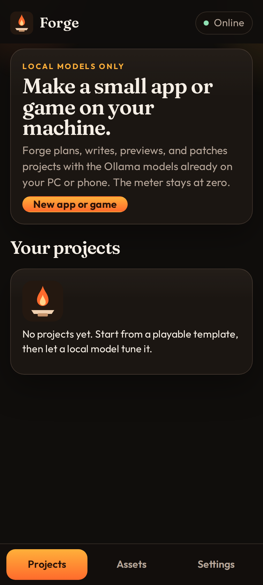
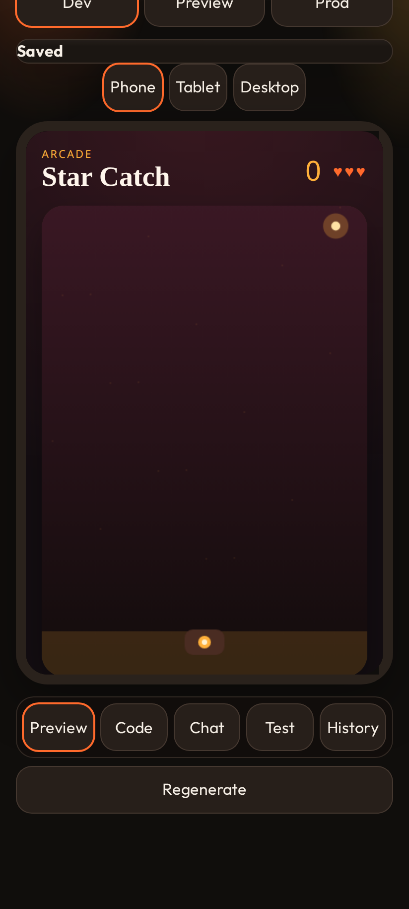
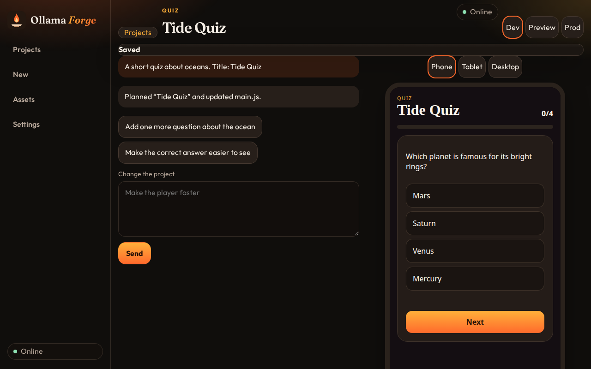

# Ollama Forge

Ollama Forge is a local app and game maker for [DowntownDiddlerrr](mailto:mscofield1588@gmail.com). It plans, writes, previews, tests, and patches small projects with the Ollama models already on your PC or phone. There is no account, no telemetry, and no cloud LLM. The cost is $0.

Made for Michael. The phone it is aimed at is a Samsung S25 Ultra. The heavy models stay on the PC.



## What it does

- New app or game from a prompt, starting from a playable template: canvas arcade, vanilla JS game, puzzle, idle clicker, quiz, utility, or landing page. Output is one folder of HTML, CSS, and JS.
- Generation is shaped for 7B–14B local models (qwen2.5-coder, llama3.1, and similar). Forge asks for a short plan, then rewrites the logic file with a tight prompt, trims context to the chosen window, and streams the reply. You can cancel.
- Live preview in a sandboxed iframe, with phone, tablet, and desktop frames.
- A smoke test that loads the preview and records console errors and uncaught exceptions. **Fix it** sends the error and the relevant file back to the model, applies the patch, and retests, at most 3 times. Templates also ship a few simple assertions.
- Every generate, edit, fix, palette change, and rollback is a snapshot. History shows a line diff. Chat edits are things like “make the player faster.”
- Dev edits the live files. Preview freezes a snapshot and, when forge-server is running, shares it on the LAN. Prod downloads a zip, or a standalone PWA zip with a manifest, icons, and a service worker.
- An asset helper draws palettes, SVG motifs, emoji badges, and CSS patterns on the device.
- A CodeMirror editor, a file tree, and settings for the planner, coder, and fixer models, plus temperature and context size.





## PC setup

You need Node.js 22 or newer, and [Ollama](https://ollama.com/).

```bash
git clone https://github.com/workinmanstrokes/ollama-forge.git
cd ollama-forge
npm install
ollama pull qwen2.5-coder:7b
npm run dev
```

Open http://127.0.0.1:5173. In Settings, leave the Ollama URL at `http://localhost:11434` and tap **Test connection**. Assign the pulled model to planner, coder, and fixer. A context size of 4096 and a temperature around 0.4 is a solid start for a 7B coder model.

Projects live in IndexedDB in the browser. They survive reloads on that browser. forge-server, below, can also write them to disk.

## Phone on the same Wi-Fi

The recommended path is forge-server. It serves the app, proxies Ollama (so the phone does not fight CORS or mixed content), and can save projects on the PC.

```bash
npm run build
npm run server
```

The server listens on `0.0.0.0:8787` and proxies to `http://127.0.0.1:11434`. On the phone, open `http://<PC-LAN-IP>:8787`. Forge notices `/api/health` and sends model calls through `/ollama`.

Find the PC address with `ipconfig` on Windows or `ip addr` on Linux. It looks like `192.168.1.40`. The phone and the PC must be on the same Wi-Fi. Guest networks often hide devices from each other.

Allow inbound TCP **8787** (and **11434** if you also connect directly) on private networks. On Windows:

```bat
netsh advfirewall firewall add rule name="Forge" dir=in action=allow protocol=TCP localport=8787
netsh advfirewall firewall add rule name="Ollama" dir=in action=allow protocol=TCP localport=11434
```

This is for a trusted home network. forge-server has no password. Do not port-forward it.

### Direct to Ollama

Use this when the phone browser or the Forge APK talks to Ollama itself. Quit the Ollama tray app first so the terminal can bind the port.

PowerShell:

```powershell
$env:OLLAMA_HOST="0.0.0.0:11434"
$env:OLLAMA_ORIGINS="*"
ollama serve
```

Command Prompt:

```bat
set OLLAMA_HOST=0.0.0.0:11434
set OLLAMA_ORIGINS=*
ollama serve
```

macOS or Linux:

```bash
OLLAMA_HOST=0.0.0.0:11434 OLLAMA_ORIGINS=* ollama serve
```

On the phone, set the Ollama URL to `http://<PC-LAN-IP>:11434` and tap **Test connection**. `OLLAMA_ORIGINS=*` is what lets the browser call Ollama. The Forge APK is served as `http://localhost`, which Ollama allows by default, but the wildcard is the setting that matches every case.

You can set the same two variables in Windows **System Properties → Environment Variables** if you want them to survive a reboot. Restart Ollama after that.

## Ollama on the phone (Termux)

On-device Ollama is optional. The S25 Ultra can run a small model. Treat 7B and larger as a PC job: they are slow and hot on a phone.

Install Termux from [F-Droid](https://f-droid.org/packages/com.termux/) or the [Termux GitHub releases](https://github.com/termux/termux-app/releases), not the old Play Store build. Then try the short path:

```bash
pkg update && pkg upgrade -y
pkg install ollama
termux-wake-lock
ollama serve
```

If that package is not in your Termux repo, use Debian inside [proot-distro](https://github.com/termux/proot-distro). Ollama’s Linux build needs glibc, which Debian has and Android’s own libc does not. Guides that match this layout: [olladroid](https://s1dd4rth.github.io/olladroid/) and [Install Ollama in Termux (2026)](https://nkaushik.in/writing/install-ollama-in-termux-android-2026-guide/).

```bash
pkg update && pkg upgrade -y
pkg install proot-distro
proot-distro install debian
proot-distro login debian
apt update && apt install -y curl ca-certificates
curl -fsSL https://ollama.com/install.sh | sh
ollama serve
```

In that same shell, pull a small model, for example `ollama pull qwen2.5-coder:1.5b`. Point Forge at `http://127.0.0.1:11434`. Run `termux-wake-lock` from Termux so Android does not kill the server when the screen sleeps.

## Install Forge itself as an APK

The repo includes a Capacitor Android project. The WebView uses `http://localhost` and cleartext traffic so it can stream from a PC running Ollama on the LAN. Do not put that APK on the public internet.

GitHub Actions builds a debug APK and keeps the artifact for 2 days (`ollama-forge-debug-apk`), plus phone-layout screenshots. To build it yourself you need a JDK 21 and the Android SDK:

```bash
npm run build
npx cap sync android
cd android && ./gradlew assembleDebug
```

The APK is `android/app/build/outputs/apk/debug/app-debug.apk`. Copy it to the S25 Ultra and open it. Android will ask you to allow installs from that source. The debug build is signed with the debug key.

## Wrap a generated project as an APK

Prod → **Download standalone PWA** gives a zip with `index.html`, `styles.css`, `main.js`, a manifest, generated icons, and a tiny service worker. Unzip it. Then either:

**Capacitor, fully on your machine**

```bash
npm create @capacitor/app@latest
# copy the unzipped files into the new app's web directory
npm install @capacitor/core @capacitor/cli @capacitor/android
npx cap add android
npx cap sync android
cd android && ./gradlew assembleDebug
```

**Bubblewrap**, if you host the unzipped folder (forge-server’s LAN preview is enough):

```bash
npm install -g @bubblewrap/cli
bubblewrap init --manifest http://<PC-LAN-IP>:8787/p/<snapshot-id>/manifest.webmanifest
bubblewrap build
```

[PWABuilder](https://www.pwabuilder.com/) can wrap a hosted manifest too. Forge does not upload the project.

## How a project is made

1. Pick a template. It already runs.
2. The planner model returns a short JSON plan: title, summary, palette, mechanics, assertions. If the JSON is unusable, Forge says so and continues with a basic plan.
3. The coder model rewrites `main.js` only. The palette is applied to the CSS variables locally, without another model call.
4. The result is a snapshot. Preview, edit in CodeMirror, or chat.
5. Smoke test loads the files in a sandboxed iframe and listens for errors. Fix it loops at most three times.

Kid-safe rules are in every model prompt: no sexual content, no graphic violence, no personal data collection, no network calls. Before a model file is applied, Forge rejects `fetch`, XHR, WebSocket, and `http`/`https` URLs (the SVG namespace is the exception). Generated projects run in a sandbox without access to Forge’s storage.

## Development

```bash
npm test          # vitest: templates, prompts, fix loop, zip, forge-server
npm run e2e       # Playwright against a mock Ollama on port 11435
npm run mock      # that mock, if you want it by hand
npm run typecheck
npm run build
npm run server    # serves dist and proxies Ollama
```

The end-to-end test creates an arcade game, checks the preview, injects `throw new Error("player crashed")` in the editor, runs the fix loop, and downloads both zips. A second test checks the desktop split view. Phone screenshots are taken at 412×915.

`mock/ollama-server.mjs` is only for tests and CI. It is not a model.

## Privacy

Forge does not include analytics, crash reporting, or ads. Settings, projects, and snapshots stay on the device (IndexedDB and localStorage) unless you save or share them through forge-server on your LAN. Nothing is sent to a hosted LLM.

## Limits

- A 7B model will sometimes write a broken game. The smoke test and fix loop are there for that, and they stop after three tries. The starter template is still playable if generation fails.
- One logic file per generation. Forge does not ask the model to invent a framework.
- Preview and Prod sharing on the LAN has no login.
- There is no iOS project.
- Turning an export into an APK is a documented local build, not a button inside Forge.
- On-device models are much slower than the PC, and 14B models do not belong on the phone.
